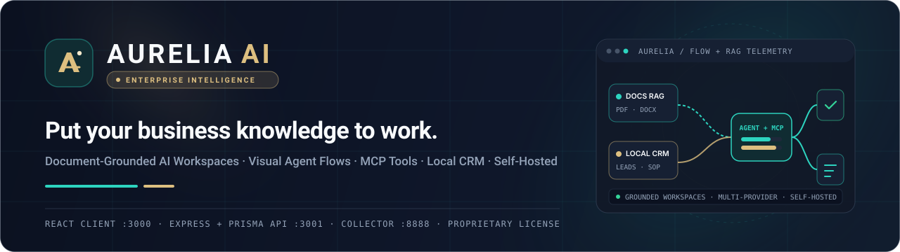
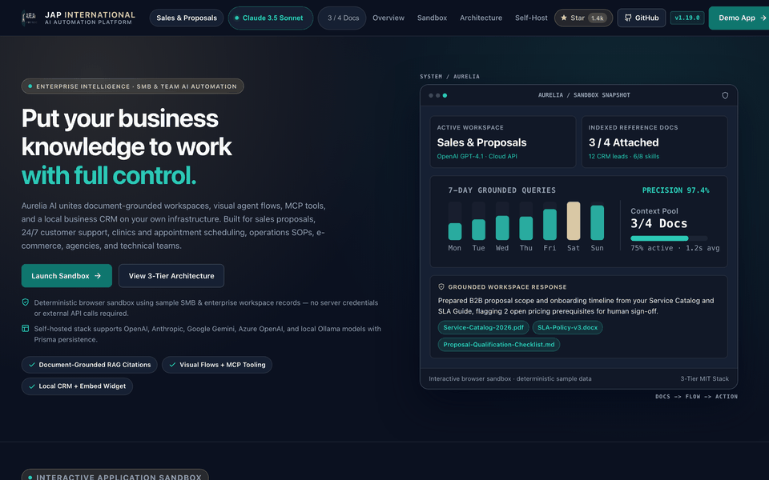
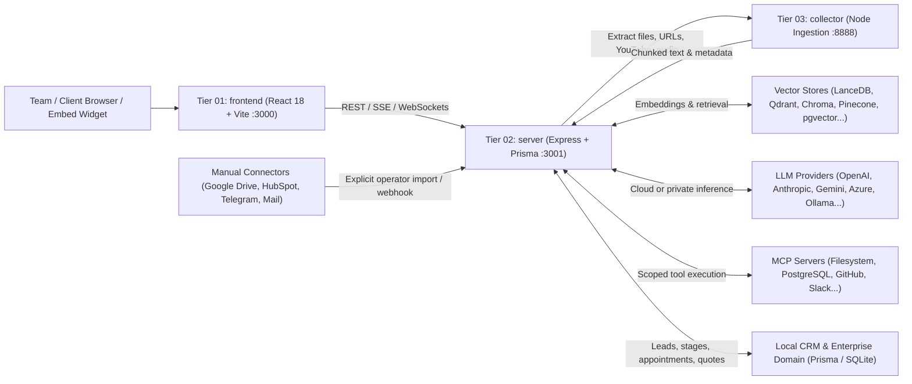

<div align="center">



<br/>

# Aurelia AI

**Put your business knowledge to work with full control.**

A self-hosted business AI automation platform for SMBs and enterprise teams across sales proposals, 24/7 customer support, clinic and appointment scheduling, operations SOPs, e-commerce, agencies, and technical workflows. Explore the live interactive sandbox on GitHub Pages or deploy the complete React 18 + Express + Prisma + Document Collector stack on your own infrastructure.

[](https://annoris.github.io/aurelia/)
[](https://github.com/annoris/aurelia/stargazers)
[](./SOURCE_ACCESS.md)
[-0b1120?style=flat-square&logo=nodedotjs&logoColor=2dd4bf)](./SOURCE_ACCESS.md)
[](./SOURCE_ACCESS.md)
[](./SOURCE_ACCESS.md)
[](LICENSE)

[**Live Interactive Sandbox**](https://annoris.github.io/aurelia/) · [**Unlock Full Source Vault (`annoris/aurelia-pro-source`)**](./SOURCE_ACCESS.md) · [Visual Walkthrough](#visual-walkthrough) · [Architecture](#how-it-works--architecture) · [Quickstart](#quickstart-browser-sandbox-local-development--docker) · [Documentation](#documentation-index) · [License](#license--third-party-notices)

<br/>



</div>

---

## Why Aurelia AI? (Aurelia vs. The Old Way)

| Capability | **Aurelia AI (Self-Hosted)** | Cloud AI SaaS Suites | DIY RAG & Automation Scripts |
|---|:---:|:---:|:---:|
| **Data Ownership & Privacy** | **100% Self-Hosted (Prisma + Local Vector DB)** | Vendor cloud storage | Self-hosted |
| **LLM Freedom (BYOK)** | **ChatGPT, Claude, Gemini, DeepSeek & Ollama** | Locked models + markup | Manual SDK glue |
| **Grounded RAG + Citations** | **Workspace-isolated docs + inline chunk citations** | Black-box retrieval | Custom pipeline required |
| **Visual Workflow + MCP Hub** | **Built-in node builder + MCP guardrails** | Per-seat add-on fees | None built-in |
| **Built-In Local CRM** | **Leads, quotes, appointments & draft follow-ups** | Separate CRM subscription | None |
| **Zero-Install Live Sandbox** | **[annoris.github.io/aurelia](https://annoris.github.io/aurelia/)** | Credit card trial | None |

---

## Table of Contents

- [What is Aurelia AI?](#what-is-aurelia-ai)
- [Visual Walkthrough](#visual-walkthrough)
- [Visual System, Typography & Accessibility](#visual-system-typography--accessibility)
- [How It Works & Architecture](#how-it-works--architecture)
- [Quickstart (Browser Sandbox, Local Development & Docker)](#quickstart-browser-sandbox-local-development--docker)
- [Repository Structure](#repository-structure)
- [Validation, Screenshots & GitHub Pages Deployment](#validation-screenshots--github-pages-deployment)
- [Roadmap](#roadmap)
- [Documentation Index](#documentation-index)
- [Contributing](#contributing)
- [License & Third-Party Notices](#license--third-party-notices)

---

## What is Aurelia AI?

**Aurelia AI** transforms the documents your organization already depends on—service catalogs, SLA terms, return policies, clinic intake guides, and field operations SOPs—into isolated AI workspaces, structured agent workflows, Model Context Protocol (MCP) tool registries, and a built-in local CRM. Whether you operate a multi-location clinic, an e-commerce support desk, a consulting agency, or an engineering organization, your team keeps complete ownership over runtime databases, document indexes, model selection, and permission guardrails.

> **Interactive Sandbox Notice:** The live [GitHub Pages showcase](https://annoris.github.io/aurelia/) runs deterministically in your browser over multi-industry sample workspace records with zero backend credentials, server storage, or outbound API calls. Self-hosting the full 3-tier stack connects real cloud or local LLM providers, vector databases, Prisma persistence, and document extraction.

### Key Highlights

- **Interactive Browser Sandbox on GitHub Pages (`site/`):** A zero-dependency HTML5, CSS3, and modular ES showcase deployed to [**annoris.github.io/aurelia**](https://annoris.github.io/aurelia/) where you can switch workspaces, attach or detach documents, simulate multi-node workflows, toggle agent skills and MCP servers, inspect CRM lead modals, and customize website embed snippets live.
- **Document-Grounded RAG Workspaces:** Isolate conversations and retrieval context per team or business function. Only documents explicitly attached to a workspace are eligible for chunk citations; unattached files in the library stay excluded.
- **Visual Agent Workflow Builder:** Chain deterministic multi-step pipelines (`Trigger & Inputs` → `Vector Retrieval` → `LLM Reasoning` → `Tool / API Action` → `Structured Output`) with editable node variables and inspectable JSON execution traces.
- **Agent Skills & MCP Server Hub:** Enforce explicit operator guardrails (`Read-Only`, `Draft Only`, `Scoped Write`, `Workspace Tool`) and compile live `aurelia_mcp_servers.json` configs for MCP integrations such as `Filesystem`, `PostgreSQL`, `GitHub`, and `Slack`.
- **Built-In Local CRM & Pipeline:** Manage multi-industry leads, pipeline stages, intake notes, appointments, quotes, and draft-only AI follow-up messages inside local Prisma storage without forcing external writeback.
- **Business Connections for Google Drive & HubSpot:** Operator-reviewed, bounded manual imports let administrators browse authorized Drive folders into the document library or preview capped 25/50/100-contact HubSpot slices into the local CRM alongside channel bridges and an embeddable website chat widget.
- **Multi-Provider LLM & Vector Store Routing:** Supports cloud APIs (OpenAI, Anthropic, Google Gemini, Azure OpenAI, Bedrock, Groq, Mistral, OpenRouter, and more) as well as local/private inference (Ollama, LM Studio, LocalAI, Lemonade) paired with LanceDB, Qdrant, Chroma, Pinecone, pgvector, Milvus, Weaviate, or Astra.
- **Self-Hosted Privacy & Solana-Gated Sponsorware Vault (`annoris/aurelia-pro-source`):** Decoupled `frontend/`, `server/`, and `collector/` services run cleanly on Node.js or Docker Compose under our [Commercial & Sponsorware Source-Gated License](LICENSE) ([Unlock Full Source via Solana](./SOURCE_ACCESS.md)), with upstream attribution preserved in [THIRD_PARTY_NOTICES.md](THIRD_PARTY_NOTICES.md).

---

## Visual Walkthrough

Every screenshot below was captured directly from the live rendered `site/` interactive sandbox ([annoris.github.io/aurelia](https://annoris.github.io/aurelia/)) using headless Google Chrome (`1440×900 @2x` desktop and `390×844 @2x` mobile) via `npm run screenshots`.

### 1. Editorial Welcome Showcase (`#welcome`)


- **On Screen:** A `#0b1120` obsidian-slate header frames the `AURELIA AI / ENTERPRISE INTELLIGENCE` brand lockup (`Overview`, `Sandbox`, `Architecture`, `Self-Host`, `Light Mode`, `GitHub`, and `Launch Sandbox`), leading into the hero headline _"Put your business knowledge to work with full control."_ and multi-industry SMB & enterprise positioning.
- **Highlights:** Subtle telemetry coordinates (`SYSTEM / AURELIA`, `DOCS -> FLOW -> ACTION`) surround the live `AURELIA / SANDBOX SNAPSHOT` card rendering the active `Sales & Proposals` workspace, `3 / 4 Attached` counter, a 7-day SVG query bar chart (`PRECISION 97.4%`), `Context Pool 3/4 Docs` meter, and grounded citation chips (`Service-Catalog-2026.pdf`, `SLA-Policy-v3.docx`, `Proposal-Qualification-Checklist.md`).
- **Try It Live:** Click **Launch Sandbox** to jump straight into the interactive workspace shell, or toggle **Light Mode** in the header to test the full light-surface palette.

---

### 2. Command Overview & Telemetry (`#view=overview`)


- **On Screen:** Beneath the sandbox status banner (`Sales & Proposals · Overview` and `Reset Sandbox`), a 4-workspace switcher (`Sales & Proposals`, `24/7 Customer Support`, `Clinic & Booking`, `Operations & SOPs`) drives the executive overview stage and sidebar summary.
- **Highlights:** Four executive KPI cards display `Attached Knowledge Docs (3 / 4)`, `Model Routing Target (OpenAI GPT-4.1)`, `Flows, Skills & MCP (4 · 6/8 · 3/4)`, and `Local CRM Pipeline ($266,800)`, paired side-by-side with the **7-Day Workspace Query Telemetry** SVG bar chart (`316 grounded runs · 97.4% precision`) and the **Knowledge Coverage & Vector Grounding** radial ring (`75% GROUNDED`, `84 active chunks`, `Citations strictly enforced`).
- **Try It Live:** Switch between all four industry workspaces to watch KPIs, query bars, vector coverage rings, and business task prompt templates recalculate in real time.

---

### 3. Document-Grounded RAG Chat & Context Panel (`#view=chat`)


- **On Screen:** A split-stage workspace pairs the **Workspace Thread** and **Send Query** composer on the left with the **Workspace Context** (`3/4 attached`) document attachment drawer on the right (`3` attached files and `1` unattached `Library` file).
- **Highlights:** Assistant replies include clickable citation chips (`Service-Catalog-2026.pdf`, `SLA-Policy-v3.docx`), an expanded **Source Chunk: Service-Catalog-2026.pdf** excerpt card (`PDF · 46 indexed chunks · Attached`), explicit disclosure when an unattached library file is excluded from retrieval, and clickable suggested prompt chips.
- **Try It Live:** Click **Detach All (Test Zero Context)** or toggle individual checkboxes in **Workspace Context**, then submit a prompt to verify how Aurelia refuses to fabricate answers when no documents are attached.

---

### 4. Visual Agent Workflow Builder (`#view=workflows`)


- **On Screen:** A 3-column Visual Agent Flows canvas presents **Agent Presets** (`4 flows`: B2B Proposal Generator, 24/7 Support Escalation Triage, Clinic Appointment Intake & Reminders, SOP-to-Checklist Converter), the 5-node **Pipeline Canvas**, and the right-hand **Node Inspector** plus **Execution Trace & Output** console.
- **Highlights:** Each connected node (`1. Trigger & Inputs`, `2. Vector Retrieval`, `3. LLM Reasoning`, `4. Tool / API Action`, `5. Structured Output`) reports live step completion (`Done · 95ms` through `Done · 75ms`), while the trace console outputs `Completed (1205ms)` with structured JSON output (`"writeMode": "Draft Only (No External Email)"`).
- **Try It Live:** Select any node to edit variables in **Node Inspector** (`accountName`, `requestedPackage`, `billingTerm`), then click **Simulate Flow Run** to watch step-by-step execution update the console payload.

---

### 5. Agent Skills & MCP Server Registry (`#view=agents`)


- **On Screen:** Under **Agents & Models**, eight **Agent Skills & Permission Guardrails** cards (`5 of 8 active`, with **Strict Citation Grounding** toggled `OFF` in this capture) sit directly above **MCP Server Integrations** (`3 of 4 compiled` across `Filesystem`, `PostgreSQL`, `GitHub`, `Slack`) and the **Live Compiled `aurelia_mcp_servers.json`** code viewer (`Copy JSON`).
- **Highlights:** Every skill explicitly labels its permission tier (`Read-Only`, `Draft Only`, `Scoped Write`, `Workspace Tool`) and authorized tool scopes, while the same view also lets operators switch between cloud/local LLM Provider Adapters and Vector Database Engines.
- **Try It Live:** Toggle any skill or MCP server switch (`ON` / `OFF`) and watch `aurelia_mcp_servers.json` recompile instantaneously.

---

### 6. Local CRM & Native Lead Inspection Modal (`<dialog id="lead-modal">`)


- **On Screen:** Clicking **Inspect & Draft** in `#view=crm` opens a centered native `<dialog id="lead-modal">` over a blurred dark backdrop for `Northstar Cold Logistics` (`pnair@northstarcold.example`, `$38,400` estimated value).
- **Highlights:** Eight structured metadata cells (`Company`, `Industry`, `Primary Contact`, `Contact Details`, `Estimated Value`, `Next Appointment`, `Channel Source`, `Account Owner`) pair with a live-updating **Pipeline Stage** dropdown (`Qualified`), **Operator Intake Notes**, and an **AI Follow-Up Message** box explicitly badged **`Draft only — not sent`** alongside **Regenerate Draft** and **Copy Draft**.
- **Try It Live:** Change the lead's pipeline stage inside the modal, regenerate the contextual follow-up draft, or press `Escape` to verify accessible modal dismissal and focus restoration.

---

### 7. Business Connections, Imports & Website Embed Customizer (`#view=connections`)


- **On Screen:** Top channel bridge cards (`Telegram Bot Bridge`, `Gmail / Outlook Draft Bridge`, `Website Chat Embed`) lead into split manual import panels for **Google Drive Manual Import** (`Folder Browser` across `Sales-Proposals-2026/`, `Support-Playbooks/`, `Clinic-and-Ops-SOPs/`) and **HubSpot Contact Batch Import** (`Batch Limit: 50` with contact preview table), followed by the **Website Chat Embed Customizer**.
- **Highlights:** Import controls enforce truthful boundaries—explicit Drive folder selection (`Stage 3 Files for Ingestion`) and capped HubSpot contact slices (`25`, `50`, or `100 Contacts`) with zero background scraping—while the embed customizer updates the **Live Website Widget Mockup** and copyable `<script>` snippet in real time.
- **Try It Live:** Switch HubSpot batch caps, browse Drive folders, or customize the embed widget title, accent color, position, and greeting to see the `<script>` snippet update live.

---

### 8. Responsive Mobile Terminal (`390×844 @2x`)


- **On Screen:** At `390×844` mobile viewports, the sticky header condenses cleanly to the `AURELIA AI` brand mark, theme toggle button, and `#mobile-nav-btn` drawer trigger, above stacked sandbox status controls, wrapping workspace pills, and a horizontal touch-scrollable view strip (`Overview`, `AI Chat & Docs`, `Visual Flows`, ...).
- **Highlights:** Enforces `44px` minimum touch targets, `16px` mobile input typography to prevent focus zoom, `tabular-nums` alignment, and verified zero horizontal overflow (`scrollWidth <= innerWidth`).
- **Try It Live:** Open the mobile navigation drawer on a narrow viewport to verify `#main-content` receives `inert` locking and focus traps cleanly until dismissed.

---

## Visual System, Typography & Accessibility

### Color Tokens (`site/assets/css/tokens.css`)

| Token | Dark Default (`[data-theme="dark"]`) | Light Toggle (`[data-theme="light"]`) | Role Across Sandbox & Showcase |
| :--- | :--- | :--- | :--- |
| `--bg` | `#0b1120` | `#f7f8fa` | Primary obsidian-slate / neutral light canvas |
| `--bg-elevated` | `#111827` | `#ffffff` | Elevated containers, telemetry frames, header backdrop |
| `--surface` | `#162033` | `#ffffff` | KPI cards, workflow nodes, skill panels, tables |
| `--surface-hover` | `#1e293b` | `#f1f5f9` | Interactive hover & active container states |
| `--border` | `rgba(148, 163, 184, 0.18)` | `#e4e7ec` | Subtle structural hairlines across cards & tables |
| `--fg` | `#f8fafc` | `#182230` | Primary headings, labels, and tabular numeric KPIs |
| `--muted` | `#94a3b8` | `#667085` | Supporting copy, timestamps, and axis annotations |
| `--accent` | `#2dd4bf` | `#0f766e` | Primary teal actions, active pills, citation highlights |
| `--gold` | `#ddbf80` | `#a88443` | Enterprise Intelligence pills, sandbox banners, peak telemetry bar |

> **Full App Theme Alignment:** The self-hosted React client (`frontend/src/index.css` — [Private Source Vault](./SOURCE_ACCESS.md)) shares the same `--font-ui` stack and navy/teal design system (`#0f172a` dark default / `#0f766e` primary action / `#2dd4bf` CTA), alongside light-theme overrides documented in [`docs/DESIGN_SYSTEM.md`](docs/DESIGN_SYSTEM.md).

### Typography & Accessibility Discipline

- **UI & Technical Font Stacks:** `--font-ui` (`ui-sans-serif, -apple-system, BlinkMacSystemFont, "Segoe UI", Roboto, "Helvetica Neue", Arial, sans-serif`) pairs with `--font-mono` (`ui-monospace, SFMono-Regular, Menlo, Monaco, Consolas, monospace`) for MCP JSON manifests, embed snippets, latencies, and tabular metrics (`tabular-nums`).
- **Vector Icons Only:** All navigation, status indicators, and cards use crisp inline SVGs in the showcase and Phosphor icons (`@phosphor-icons/react`) in the full React app—zero raw OS emojis in template rows or buttons.
- **Mobile & Keyboard Ergonomics (`site/assets/css/accessibility.css`):** Skip-to-content link (`#main-content`), `44px` minimum height on interactive buttons and pills, `16px` input font size below `768px`, high-contrast `:focus-visible` outlines, native `<dialog>` `Escape` dismissal, `inert` main-region locking while `#mobile-drawer` is open, and `@media (prefers-reduced-motion: reduce)` transitions.

---

## How It Works & Architecture

Aurelia AI separates presentation, authorization/agent orchestration, and document extraction into three independent Node.js applications:



### Capability Matrix

| Capability | Verified Implementation & Scope ([Private Source Vault](./SOURCE_ACCESS.md)) |
| :--- | :--- |
| **LLM Provider Routing** | Adapters in `server/utils/AiProviders/` including OpenAI, Anthropic, Google Gemini, Azure OpenAI, AWS Bedrock, Ollama, LM Studio, LocalAI, Groq, Mistral, DeepSeek, OpenRouter, Vertex AI, xAI, and Generic OpenAI. |
| **Vector Databases & Embeddings** | Supports LanceDB (default embedded), Qdrant, Chroma, ChromaCloud, Pinecone, pgvector, Milvus, Zilliz, Weaviate, and Astra (`server/utils/vectorDbProviders/`) paired with 14 embedding adapters (`server/utils/EmbeddingEngines/`). |
| **Document Collector (`collector/`)** | Isolated Node.js service extracting text from PDF, DOCX, XLSX, PPTX, TXT, Markdown, HTML/web links, YouTube transcripts, and audio before separate workspace embedding and vector attachment. |
| **Visual Agent Flows & Skills** | Multi-step agent flow endpoints (`server/endpoints/agentFlows.js`), agent skill whitelisting (`server/endpoints/agentSkillWhitelist.js`), WebSocket execution (`server/endpoints/agentWebsocket.js`), and default flow templates in `server/storage/plugins/agent-flows/`. |
| **MCP Server Integration** | Admin-configured Model Context Protocol registry (`server/endpoints/mcpServers.js`, `@modelcontextprotocol/sdk`) exposing scoped external tools to workspace agents. |
| **Local CRM & Enterprise Domain** | Lead tracking, pipeline stages, quotes, and omnichannel catalog definitions in `server/domain/enterprise/` and `server/endpoints/enterprise.js`. |
| **Business Connections** | Administrator-protected manual Google Drive folder import (`server/services/googleDrive/`), bounded HubSpot contact batch import (`server/services/hubspot/`), Telegram bot bridge, Gmail/Outlook skill bridges, and embeddable chat widget management (`server/endpoints/embedManagement.js`). |
| **Interactive GitHub Pages Showcase** | Zero-dependency static sandbox deployed live at [**annoris.github.io/aurelia**](https://annoris.github.io/aurelia/) illustrating all 4 SMB/enterprise workspaces, RAG context toggling, flow simulation, MCP compilation, CRM inspection, and embed customization client-side. |

---

## Quickstart (Browser Sandbox, Local Development & Docker)

> [!IMPORTANT]
> **Solana-Gated Sponsorware Architecture (`annoris/aurelia-pro-source`):**
> - **Live Interactive Browser Sandbox:** Anyone can explore the live 6-view interactive sandbox at **[https://annoris.github.io/aurelia/](https://annoris.github.io/aurelia/)** and inspect all 8 visual walkthrough sections, 3-tier architecture specifications, and integration docs right here in this public showcase repository.
> - **Full Editable 3-Tier Source Vault:** The complete, unminified 3-tier platform (`frontend/`, `server/`, `collector/`, `docker/`, `scripts/`, and `site/`) is hosted inside the **Private Source Vault (`annoris/aurelia-pro-source`)** and unlocked immediately upon contributing via **Solana Mainnet (`3HvUMCUSSHEdtA35UuD4J7mbgpTxJ7LgT2X7GfdzvBdm`)** and submitting a **[🔓 Solana Source Code Unlock Request](https://github.com/annoris/aurelia/issues/new?template=source_unlock_request.md)**. See [`SOURCE_ACCESS.md`](./SOURCE_ACCESS.md) and [`PAYMENT.md`](./PAYMENT.md) for instant unlock instructions.

### Option 1: Preview the Interactive Browser Sandbox (`Node >=18`, zero install)

```bash
git clone https://github.com/annoris/aurelia-pro-source.git
cd aurelia-pro-source
npm run pages:dev
# Serves site/ locally at http://127.0.0.1:4176
```

### Option 2: Run the Full 3-Tier Stack Locally

Requires **Node.js `>=18`** (the repository pins `v24.22.2` in `.nvmrc`) and **npm**.

```bash
git clone https://github.com/annoris/aurelia-pro-source.git
cd aurelia-pro-source

# 1. Install dependencies for each application
npm --prefix server install
npm --prefix collector install
npm --prefix frontend install

# 2. Copy *.env.example templates (non-destructive; preserves existing .env files)
npm run setup:envs

# 3. Generate Prisma client, apply local SQLite migrations, and seed initial setup
npm run prisma:generate
npm run prisma:migrate
npm run prisma:seed
# (Or run `npm run setup` to execute steps 1–3 automatically on a fresh clone)

# 4. Run non-destructive local diagnostics and launch all 3 services
npm run doctor
npm run dev:local
# Web UI: http://localhost:3000 · Express API: http://localhost:3001 · Collector: http://localhost:8888
```

### Option 3: Deploy with Docker Compose

Requires **Docker** and **Docker Compose**.

```bash
git clone https://github.com/annoris/aurelia-pro-source.git
cd aurelia-pro-source
cp -n docker/.env.example docker/.env && docker compose -f docker/docker-compose.yml up -d --build
# Serves bundled UI + API on http://localhost:3001 with persistent storage mounts
```

For Linux/macOS bare-metal production deployments behind Nginx (including WebSocket upgrades and LLM response streaming), see [`BARE_METAL.md`](BARE_METAL.md).

---

## Repository Structure

```text
aurelia/
├── site/                          # Buildless GitHub Pages interactive showcase
│   ├── .nojekyll                  # Direct static serving on GitHub Pages
│   ├── index.html                 # Semantic showcase shell, 6-view sandbox & <dialog> lead modal
│   └── assets/
│       ├── css/                   # tokens.css, base.css, layout.css, components.css, accessibility.css
│       ├── img/                   # logo-mark.svg, favicon.svg, og-card.svg
│       └── js/                    # data.js, state.js, charts.js, renderers.js, app.js
├── frontend/                      # Tier 01: React 18 + Vite + Tailwind CSS web client (:3000)
├── server/                        # Tier 02: Express API, Prisma ORM, RAG, agents, MCP & local CRM (:3001)
├── collector/                     # Tier 03: Document, web link, YouTube & audio extractor (:8888)
├── docker/                        # Multi-arch Dockerfile, docker-compose.yml, .env.example & HOW_TO_USE_DOCKER.md
├── scripts/
│   ├── serve-pages.mjs            # Local static preview server for site/ (127.0.0.1:4176)
│   ├── validate-pages.mjs         # HTML IDs/anchors, CSS url(), JS syntax, SVG, screenshot & README checks
│   ├── capture-screenshots.mjs    # Headless Chrome CDP screenshot & live smoke-check suite
│   ├── doctor.mjs                 # Read-only local Node, dependency, .env & Prisma diagnostics
│   └── dev-local.mjs              # Coordinated 3-service local development runner
├── extras/
│   ├── scripts/verifyPackageVersions.mjs
│   └── translator/
├── docs/
│   ├── screenshots/               # 8 live headless Chrome PNG screenshots + README.md
│   ├── ARCHITECTURE.md            # 3-tier boundaries, module map & request flow
│   ├── DEVELOPMENT.md             # Local ports, env setup, diagnostics & verification
│   ├── INTEGRATIONS.md            # Drive, HubSpot, MCP, channel bridges & credential rules
│   ├── DESIGN_SYSTEM.md           # UI typography, tokens, layout & truthful behavior contract
│   └── GITHUB_GROWTH_GUIDE.md     # Repository metadata, topics, Pages & release checklist
├── .github/
│   ├── assets/banner.svg          # Repository README header banner
│   ├── ISSUE_TEMPLATE/            # Structured bug, feature, docs & integration forms
│   ├── PULL_REQUEST_TEMPLATE.md
│   ├── FUNDING.yml
│   └── workflows/
│       ├── ci.yml                 # Script syntax, Pages validation, package & locale verification
│       └── pages.yml              # Automated GitHub Pages build & deployment from site/
├── package.json                   # Root npm orchestration scripts (Engines: Node >=18)
├── .nvmrc                         # Pinned Node version (v24.22.2)
├── BARE_METAL.md                  # Non-Docker production build & Nginx proxy guide
├── CHANGELOG.md                   # Semantic version release notes
├── CODE_OF_CONDUCT.md             # Contributor Covenant v2.1
├── CONTRIBUTING.md                # Contributor setup, PR guidelines & connector criteria
├── SECURITY.md                    # Coordinated vulnerability disclosure & scope policy
├── LICENSE                        # MIT License (Copyright (c) 2026 Aurelia AI)
└── THIRD_PARTY_NOTICES.md         # Upstream MIT notices (Mintplex Labs Inc.)
```

---

## Validation, Screenshots & GitHub Pages Deployment

Run the full verification pipeline from the repository root (`Node >=18`):

```bash
# Validate site/, scripts/, README links, screenshot PNG integrity, shared packages & locale schemas
npm run verify

# Preview the GitHub Pages showcase locally on http://127.0.0.1:4176
npm run pages:dev

# Run static HTML/CSS/JS/README/screenshot validation only
npm run pages:check

# Regenerate all 8 screenshots in docs/screenshots/ via headless Google Chrome CDP
npm run screenshots

# Run ESLint checks across server, frontend, and collector
npm run lint:ci

# Run Jest unit tests from the repository root
npm test

# Run read-only local prerequisite diagnostics
npm run doctor
```

### Automated CI & GitHub Pages Workflows

1. **Continuous Integration (`.github/workflows/ci.yml` — Private Source Vault):** Syntax-checks `scripts/*.mjs`, validates `site/` and `README.md` via `node scripts/validate-pages.mjs`, verifies shared dependency versions between `server` and `collector`, and checks all frontend locale files.
2. **Automated GitHub Pages (`origin/gh-pages`):** Publishes the protected interactive sandbox directly to **`https://annoris.github.io/aurelia/`**.

---

## Roadmap

- **Current (`v1.19.0`):** Self-hosted 3-tier platform (`frontend`, `server`, `collector`), multi-provider LLM & vector routing, document-grounded workspaces, visual agent workflows, MCP registry, local CRM, manual Google Drive & HubSpot imports, embeddable website widget, and live interactive GitHub Pages showcase.
- **Planned / Future Work:** Expanded connectors tracked in [`docs/INTEGRATIONS.md`](docs/INTEGRATIONS.md) (operational WhatsApp Business messaging, Microsoft 365 document import, and n8n workflow triggers) alongside automated connector sync improvements and enhanced workspace analytics.

---

## Documentation Index

- **Source Code Unlock & Commercial Licensing:** [Source Code Unlock Guide](SOURCE_ACCESS.md) · [Commercial Licensing & Solana Treasury (`3HvUMC...fdzvBdm`)](PAYMENT.md) · [Hall of Patrons](SPONSORS.md)
- **Architecture & System Specs:** [Architecture & Module Boundaries](docs/ARCHITECTURE.md) · [Design System Contract](docs/DESIGN_SYSTEM.md)
- **Setup & Deployment:** [Local Development Guide](docs/DEVELOPMENT.md) · [Bare-Metal Production Guide](BARE_METAL.md)
- **Integrations & Visuals:** [Business Connections & Connectors](docs/INTEGRATIONS.md) · [Screenshot Suite Guide](docs/screenshots/README.md) · [GitHub Growth & Release Checklist](docs/GITHUB_GROWTH_GUIDE.md)
- **Governance & Releases:** [Changelog](CHANGELOG.md) · [Contributing Guidelines](CONTRIBUTING.md) · [Security Policy](SECURITY.md) · [Code of Conduct](CODE_OF_CONDUCT.md)

---

## 💎 Solana QR Payment, Source Vault Unlock & Commercial Licensing

To unlock the **Full Editable 3-Tier Source Code Vault (`annoris/aurelia-pro-source`)**, acquire a **Commercial Agency / Enterprise White-Label License**, or sponsor ongoing development, simply **scan the official Solana QR code below** with your phone or wallet app:

<div align="center">

<a href="https://solscan.io/account/3HvUMCUSSHEdtA35UuD4J7mbgpTxJ7LgT2X7GfdzvBdm">
  
</a>

### Official Solana Mainnet Address (`SOL` / `USDC-SPL`)

```text
3HvUMCUSSHEdtA35UuD4J7mbgpTxJ7LgT2X7GfdzvBdm
```

<p>
  <strong>1-Step Payment:</strong> Scan the QR code above with Phantom, Solflare, Backpack, Coinbase, Binance, or Trust Wallet (or copy the Solana address above) to send <strong>SOL</strong> directly, then submit a <a href="https://github.com/annoris/aurelia/issues/new?template=source_unlock_request.md"><strong>🔓 Solana Source Code Unlock Request</strong></a>.
</p>

</div>

---

## Contributing

Contributions, bug reports, documentation improvements, and connector proposals are welcome! Read [`CONTRIBUTING.md`](CONTRIBUTING.md) before opening a pull request, use the templates in [`.github/ISSUE_TEMPLATE/`](.github/ISSUE_TEMPLATE/), and report security findings privately as outlined in [`SECURITY.md`](SECURITY.md).

If **Aurelia AI** helps your team automate document-grounded workflows on your own infrastructure, consider starring the repository and sponsoring via Solana (`3HvUMCUSSHEdtA35UuD4J7mbgpTxJ7LgT2X7GfdzvBdm`) to support ongoing development.

---

## License & Third-Party Notices

- **License:** Distributed under the [**Commercial & Sponsorware Source-Gated License (On-Chain Solana Treasury Edition)**](LICENSE) — `Copyright (c) 2026 Aurelia AI`.
- **Third-Party Attribution:** Aurelia AI incorporates adapted open-source components originally created by [AnythingLLM / Mintplex Labs Inc.](https://github.com/Mintplex-Labs/anything-llm). All original MIT copyright and permission notices are preserved in [**THIRD_PARTY_NOTICES.md**](THIRD_PARTY_NOTICES.md).

---

## Companion Projects

- **[Aetheris (`annoris/aetheris`)](https://github.com/annoris/aetheris)** — Local-first AI Agents & Automation Control Plane (77 specialized agents, 328 skills, MCP manager, Prompt Workbench & 1-click Bundle Builder) · [Live Demo](https://annoris.github.io/aetheris/)
- **[Tabvento (`annoris/tabvento`)](https://github.com/annoris/tabvento)** — Local AI Browser Automation Dashboard built on Browser Use with BYOK (ChatGPT, Claude, Gemini, DeepSeek, Ollama) & SQLite history · [Live Demo](https://annoris.github.io/tabvento/)
