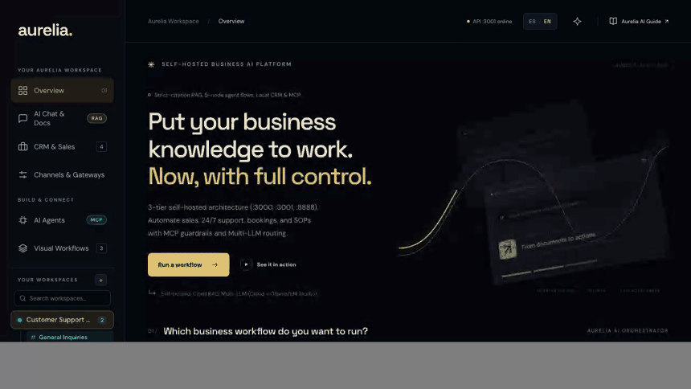
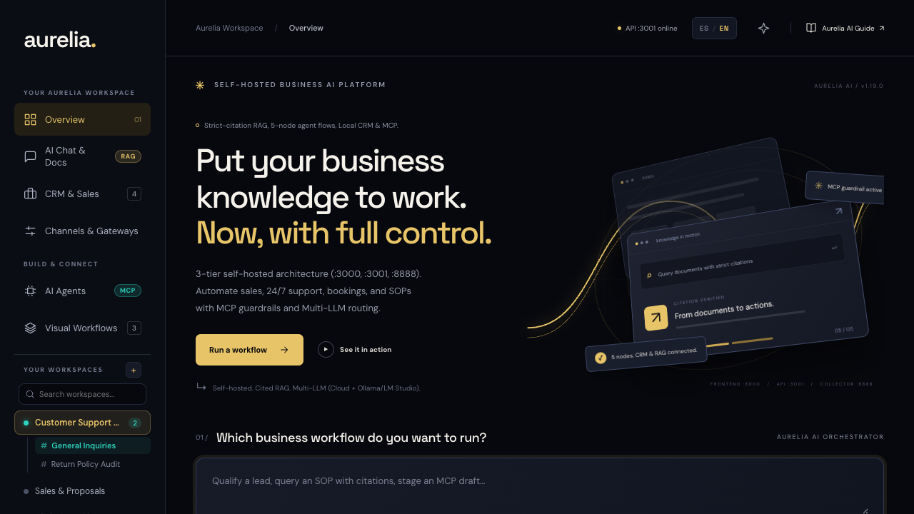
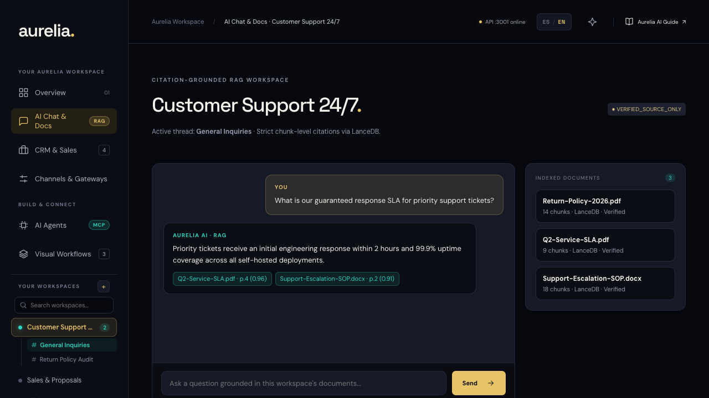
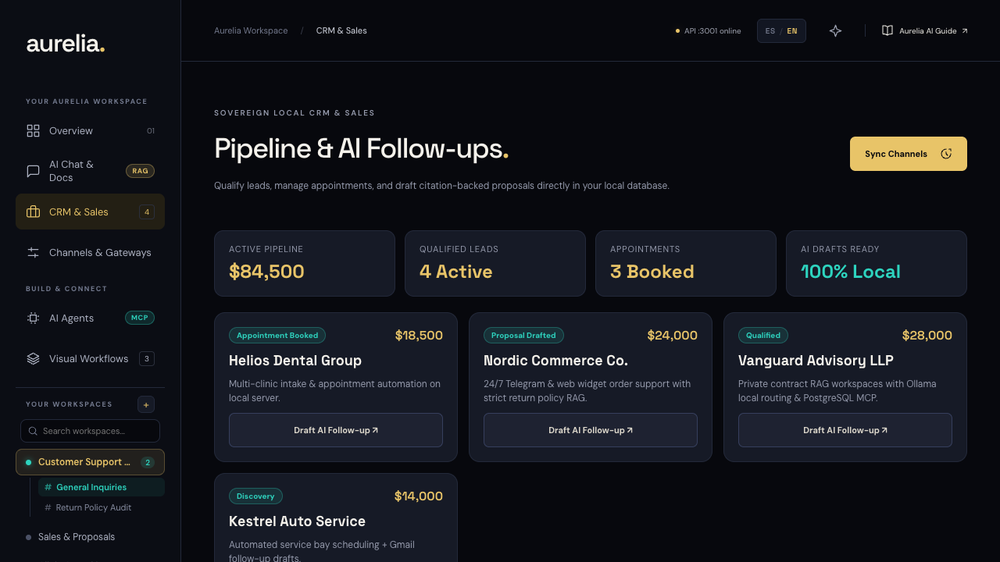
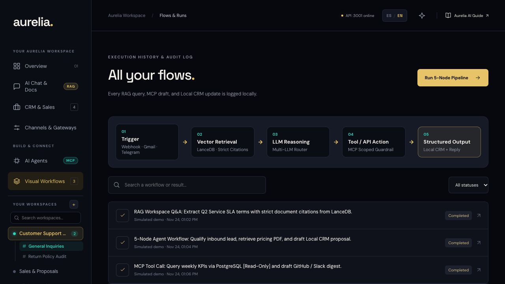
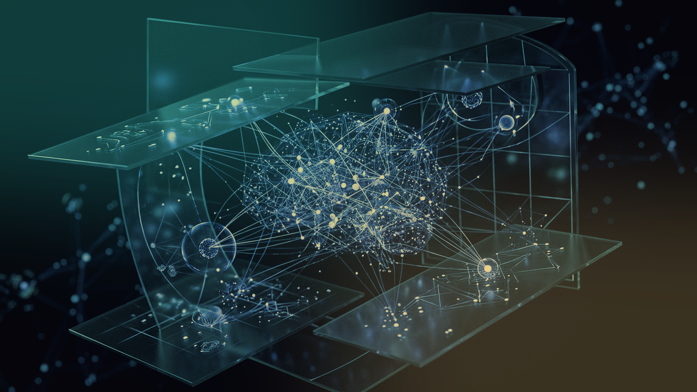
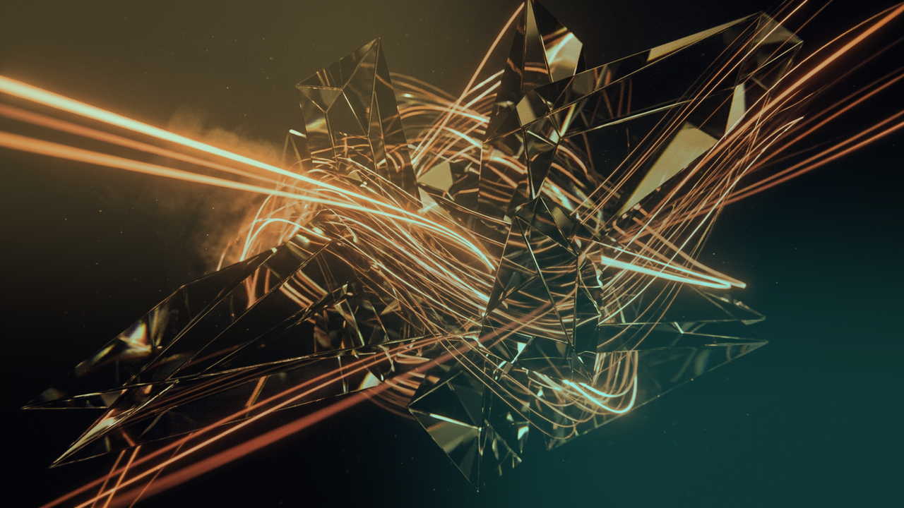
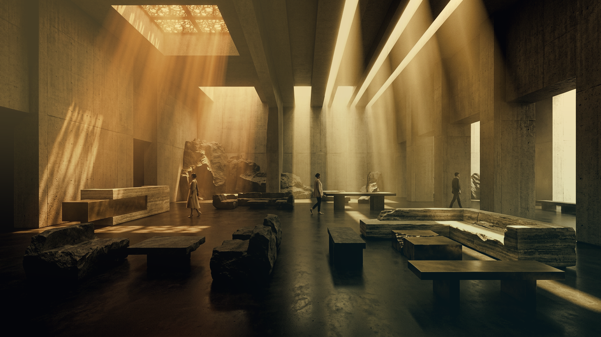
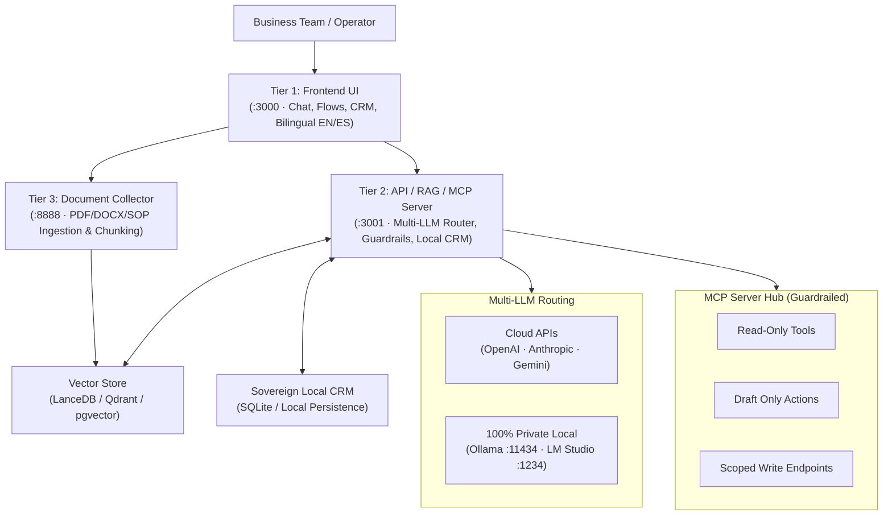

<div align="center">
  <a href="https://annoris.github.io/aurelia/">
    
  </a>

  <h1>AURELIA AI — Self-Hosted Enterprise AI Intelligence &amp; Business Automation Platform</h1>

  <p>
    <strong>Put your business knowledge to work with full control — Citation-Grounded RAG, 5-Node Visual Agent Workflows, Local CRM, MCP Server Hub &amp; Multi-LLM Routing. 100% Private. Zero Cloud Lock-In.</strong>
  </p>
  <p>
    <sub><em>Pon el conocimiento de tu negocio a trabajar con control total · RAG con citas estrictas, agentes visuales de 5 nodos, CRM local, MCP Server Hub y enrutamiento Multi-LLM (Cloud + Ollama / LM Studio).</em></sub>
  </p>

  <p>
    <a href="https://annoris.github.io/aurelia/">
      
    </a>
    &nbsp;
    <a href="https://github.com/annoris/aurelia">
      
    </a>
  </p>

  <p>
    <a href="https://github.com/annoris/aurelia/stargazers">
      
    </a>
    <a href="https://github.com/annoris/aurelia/network/members">
      
    </a>
    <a href="https://github.com/annoris/aurelia/issues">
      
    </a>
    <br />
    
    
    
    
    
  </p>

  <p>
    <a href="#-what-does-aurelia-ai-actually-do-qué-hace-aurelia-ai">What It Does</a> ·
    <a href="#-real-platform-screenshots--visual-gallery">Live Screenshots</a> ·
    <a href="#-under-the-hood-technical-curiosity-teasers">Architecture &amp; Guardrails</a> ·
    <a href="#-contribute-or-sponsor-to-unlock-full-self-hosted-source-annorisaurelia-pro-source">Unlock Full Source</a>
  </p>
</div>

---

<div align="center">
  
  <br />
  <h3>⭐ Own your AI stack. Star <code>annoris/aurelia</code> &amp; test the Live Interactive UI right now!</h3>
  <sub><em>Explora los 24 flujos empresariales en vivo en <a href="https://annoris.github.io/aurelia/">annoris.github.io/aurelia</a> — bilingüe EN / ES, sin registros ni fricción.</em></sub>
</div>

---

## 🚀 What Does Aurelia AI Actually Do? (*¿Qué hace Aurelia AI?*)

Most companies want AI automation—**not** fragile chatbots that hallucinate pricing, leak private PDFs to random SaaS clouds, or mutate CRM records without approval.

**Aurelia AI** (`v1.19.0`) is a **self-hosted enterprise AI workspace** engineered for **SMBs (PyMEs), agencies, clinics, e-commerce teams, automotive dealers, and enterprise operations** built on **6 unified engines**:

1. **📚 Citation-Grounded RAG Engine**: Ingests PDFs, SOPs, catalogs, and contracts via the Document Collector (`:8888`) and answers with **strict per-document citations**—zero fabricated policies.
2. **⚡ 5-Node Visual Agent Workflows**: Build deterministic multi-step automations (`Trigger → Vector Retrieval → LLM Reasoning → Tool/API Action → Structured Output`) with live audit traces.
3. **📇 Sovereign Local CRM &amp; Sales Pipeline**: Qualify inbound leads, score urgency, generate proposals from indexed catalogs, and track deals locally with zero SaaS per-seat tax.
4. **🛡️ MCP Server Hub with Explicit Guardrails**: Connect external tools under strict execution modes—**`Read-Only`**, **`Draft Only`**, or **`Scoped Write`**—keeping humans in control of every sensitive action.
5. **🔀 Multi-LLM Routing (Cloud + Local)**: Route complex synthesis to **OpenAI, Anthropic, or Gemini**, or run 100% air-gapped on **Ollama** and **LM Studio**.
6. **🔐 Zero-Telemetry Self-Hosted Vault**: Your documents, vector embeddings, CRM records, and execution logs never leave your own infrastructure.

### Real-World Business Use Cases (*Casos de Uso Reales*)

| Industry / Team | Automated Workflows in Aurelia AI | Guardrail Policy |
| :--- | :--- | :---: |
| **Sales &amp; Proposals** | Inbound lead qualification, PDF-grounded executive proposals, post-call follow-ups &amp; CRM pipeline hygiene | `Draft Only` / `Scoped Write` |
| **24/7 Customer Support** | Policy-cited FAQ responses, automated ticket triage, critical incident escalation briefs | `Read-Only` / `Draft Only` |
| **Clinics &amp; Booking** | Patient intake prep, pre-visit protocol reminders from PDFs, automated calendar rescheduling via MCP | `Draft Only` |
| **Operations &amp; SOPs** | Strict SOP lookup, contract clause extraction, internal compliance audits &amp; new-hire onboarding | `Read-Only` |

---

## 🖼️ Real Platform Screenshots &amp; Visual Gallery

### Live Production Interface (Real Captures)

| Overview &amp; Mission Composer (`ui-overview.png`) | AI Chat &amp; Strict-Citation RAG (`ui-chat-rag.png`) |
| :---: | :---: |
|  |  |

| Sovereign Local CRM &amp; Sales Pipeline (`ui-crm-sales.png`) | Visual 5-Node Agent Workflows (`ui-workflows.png`) |
| :---: | :---: |
|  |  |

### Architectural Concept Visuals

| Platform Hero (`hero-aurelia.png`) | Citation-Grounded RAG (`workspace-rag.png`) |
| :---: | :---: |
|  |  |

| 5-Node Agent Orchestration (`agent-workflows.png`) | Self-Hosted Privacy Vault (`selfhost-vault.png`) |
| :---: | :---: |
|  |  |

---

## 🔥 Under the Hood (Technical Curiosity Teasers)

Click any layer below to inspect how **Aurelia AI** eliminates hallucinations and uncontrolled agent side effects:

<details open>
<summary><strong>📚 1. Strict Citation RAG (LanceDB / Qdrant / pgvector — Zero Hallucinations)</strong></summary>

<br />

The **Document Collector (`:8888`)** parses PDFs, DOCX, Markdown, and SOP manuals into overlapping semantic chunks tagged with `documentId`, `page`, and `sectionHash`. Retrieval enforces a strict grounding contract: if no chunk clears the similarity threshold, the agent refuses to fabricate an answer and flags the gap instead.

</details>

<details>
<summary><strong>⚡ 2. Deterministic 5-Node Visual Agent Workflows</strong></summary>

<br />

Rather than letting an open-ended agent loop burn tokens unpredictably, Aurelia AI structures business automations into **5 auditable nodes**:

```text
[1. Trigger] ──▶ [2. Vector Retrieval (RAG)] ──▶ [3. LLM Reasoning] ──▶ [4. Tool / MCP Action] ──▶ [5. Structured Output / CRM]
```

Every node logs inputs, retrieved citations, latency, and guardrail status directly into your local audit store.

</details>

<details>
<summary><strong>🛡️ 3. MCP Server Hub &amp; Explicit Guardrails (<code>Read-Only</code> · <code>Draft Only</code> · <code>Scoped Write</code>)</strong></summary>

<br />

Every Model Context Protocol (MCP) tool connected to Aurelia AI must declare an explicit execution policy:

- **`Read-Only`**: Query order status, calendar slots, or knowledge bases with zero mutation risk.
- **`Draft Only`**: Stage emails, quotes, and calendar updates for 1-click human approval before dispatch.
- **`Scoped Write`**: Execute bounded, schema-validated writes (e.g., append CRM note + follow-up tag) with full audit logging.

</details>

<details>
<summary><strong>🏗️ 4. 3-Tier Self-Hosted Architecture (<code>:3000</code> · <code>:3001</code> · <code>:8888</code>)</strong></summary>

<br />

Aurelia AI separates UI, orchestration/RAG/MCP, and document ingestion into three clean, independently scalable local services:



</details>

---

## 🔒 Contribute or Sponsor to Unlock Full Self-Hosted Source (`annoris/aurelia-pro-source`)

This public repository (**[`annoris/aurelia`](https://github.com/annoris/aurelia)**) gives everyone immediate access to:
- The **Live Interactive UI** ([`annoris.github.io/aurelia`](https://annoris.github.io/aurelia/)) with 24 real business presets in EN &amp; ES
- The full **3-tier architecture documentation** &amp; real platform screenshots in `./docs/media/`

The **complete downloadable self-hosted source code** (`Frontend :3000`, `API/RAG/MCP Server :3001`, `Document Collector :8888`, Dockerless local runtime, and full CRM/MCP modules) lives in the private repository **[`annoris/aurelia-pro-source`](https://github.com/annoris/aurelia-pro-source)**.

### Two Ways to Unlock `annoris/aurelia-pro-source`

1. **🤝 Contribute-to-Unlock (Open-Source Contributors)**:
   - Star [`annoris/aurelia`](https://github.com/annoris/aurelia) and submit a high-signal Pull Request (documentation improvements, MCP guardrail specs, workflow blueprints, translations) or detailed technical audit Issue following **[`CONTRIBUTING.md`](./CONTRIBUTING.md)**. Approved contributors receive an official GitHub invite to `annoris/aurelia-pro-source`.
2. **⚡ Sponsorware Vault (Solana Mainnet Fast-Track)**:
   - Support independent self-hosted AI engineering via our official Solana Mainnet Sponsorware Vault to unlock instant collaborator access to `annoris/aurelia-pro-source`:
   - **Official Solana Mainnet Wallet:** `3HvUMCUSSHEdtA35UuD4J7mbgpTxJ7LgT2X7GfdzvBdm`
   - Include your GitHub handle (`@username`) in the transaction memo or share the Base58 transaction signature as described in **[`CONTRIBUTING.md`](./CONTRIBUTING.md)**.

---

## 📣 Share Aurelia AI

Believe businesses deserve private, citation-grounded AI with real guardrails? Help put **Aurelia AI** on the radar:

<div align="center">
  <a href="https://twitter.com/intent/tweet?text=Just%20discovered%20Aurelia%20AI%20%E2%80%94%20a%20Self-Hosted%20Enterprise%20AI%20Platform%20with%20Citation-Grounded%20RAG%2C%205-Node%20Visual%20Agent%20Workflows%2C%20Local%20CRM%2C%20MCP%20Guardrails%20%26%20Multi-LLM%20Routing%20%F0%9F%94%A5%20Live%20UI%3A&url=https%3A%2F%2Fgithub.com%2Fannoris%2Faurelia&hashtags=AIAgents,RAG,SelfHosted,MCP,OpenSource,GitHubTrending">
    
  </a>
  &nbsp;
  <a href="https://www.linkedin.com/sharing/share-offsite/?url=https%3A%2F%2Fgithub.com%2Fannoris%2Faurelia">
    
  </a>
  &nbsp;
  <a href="https://annoris.github.io/aurelia/">
    
  </a>
</div>

<br />

<div align="center">
  <sub><strong>Aurelia AI</strong> (`v1.19.0`) · Put your business knowledge to work with full control · <a href="https://annoris.github.io/aurelia/">annoris.github.io/aurelia</a></sub>
</div>
